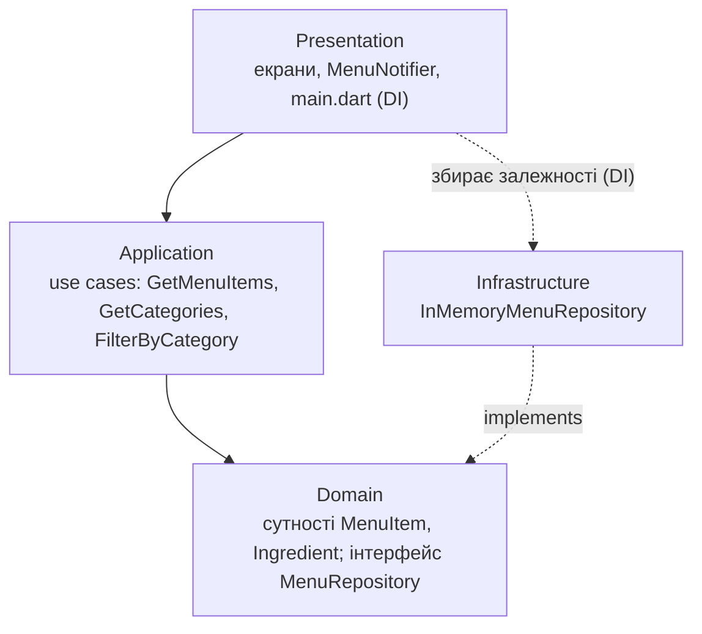

# Онлайн-меню закладу

Навчальний застосунок на Flutter, побудований за принципами **Clean Architecture**.
Користувач вибирає категорію страв, переглядає список і відкриває картку страви
з вибором кількості порцій та кнопкою замовлення.

## Схема архітектури



Залежності спрямовані всередину: зовнішні шари знають про внутрішні, а не навпаки.
Domain не залежить ні від чого (навіть від Flutter), Application працює лише з
інтерфейсом `MenuRepository`, а конкретне сховище підставляється в `main.dart`.

## Структура каталогів

```
lib/
  domain/           сутності та інтерфейси (чистий Dart)
    entities/       MenuItem, Ingredient
    repositories/   MenuRepository (інтерфейс)
  application/      сценарії використання
    use_cases/      GetMenuItems, GetCategories, FilterByCategory
  infrastructure/   реалізації та дані
    data/           початкові дані меню
    repositories/   InMemoryMenuRepository
  presentation/     інтерфейс користувача
    notifiers/      MenuNotifier (Provider / ChangeNotifier)
    screens/        MenuScreen, DishScreen
    utils/          допоміжні розширення
  config/           AppConfig
  main.dart         точка входу, Dependency Injection
```

## Збірка і запуск

```
flutter pub get
flutter run
```

## Git-процес

- `main` - стабільний код, `develop` - інтеграційна гілка, `feature/*` - гілки під задачі.
- Коміти оформлюються за Conventional Commits (`feat`, `fix`, `refactor`, `docs`, `chore`).
- Версія релізу позначена тегом `v1.0.0`.
